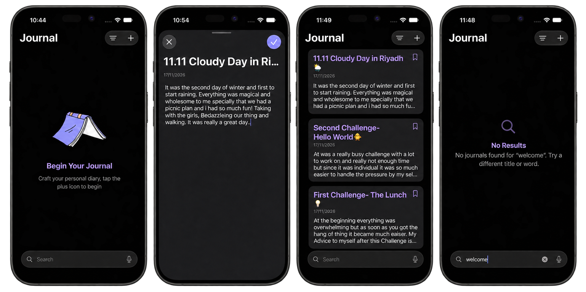

# 📔 Journali
### Your thoughts, your story.

Journali is an iOS journaling app for capturing daily thoughts and experiences. Built with SwiftUI and MVVM, it brings a provided UI design to life.

## 📱 What Users Can Do

- **✍️ Create Journals:** Write a title and journal content, then save the entry.
- **📝 Edit Journals:** Open an existing entry, update its content, and save or discard changes.
- **🔖 Bookmark Journals:** Add or remove bookmarks to highlight important entries.
- **🗂️ Sort & Filter:** View entries from newest to oldest or show only bookmarked journals.
- **🔍 Search Journals:** Find entries by searching their titles or content.
- **🎙️ Search by Voice:** Use the microphone to turn speech into a search query.
- **🗑️ Delete Journals:** Swipe an entry to reveal the delete action, then confirm or cancel.
- **💾 Keep Entries Saved:** Access locally saved entries after closing and reopening the app.
  
## ✨ Added Features

### 🎙️ Voice Search
Search journal entries using your voice. Speech is converted into text, updating search results as you speak.

### 🔍 No Results State
A helpful message appears when no journal entries match your search, with a suggestion to try a different title or word.

### 💾 Local Data Persistence
Journal entries are saved locally using @AppStorage and JSON encoding, keeping your entries available after closing and reopening the app.

## 🛠️ Technologies Used

- **Swift** — Programming language
- **SwiftUI** — User interface
- **MVVM** — App architecture
- **Speech** — Speech recognition
- **AVFoundation** — Microphone and audio recording
- **@AppStorage** — Local data persistence
- **Codable** — JSON encoding and decoding for journal entries

## 🎨 Design

Implemented from a provided UI design, with added voice search, a no-results state, and local data persistence.

  

